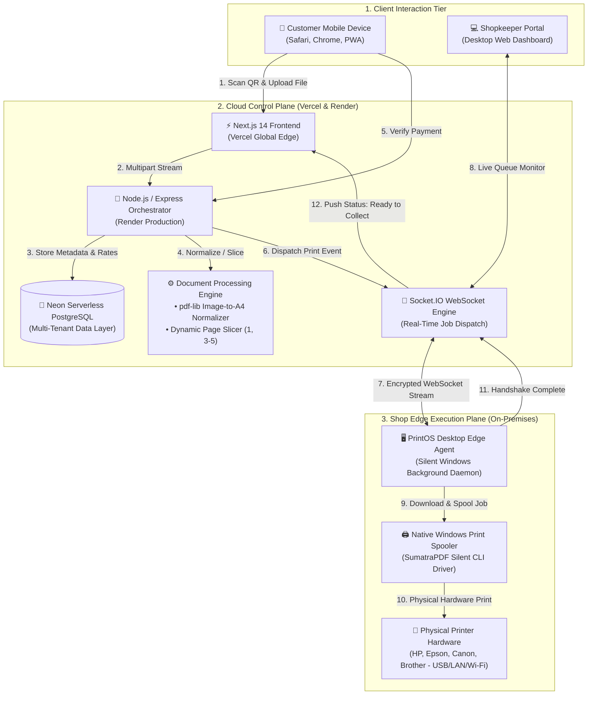
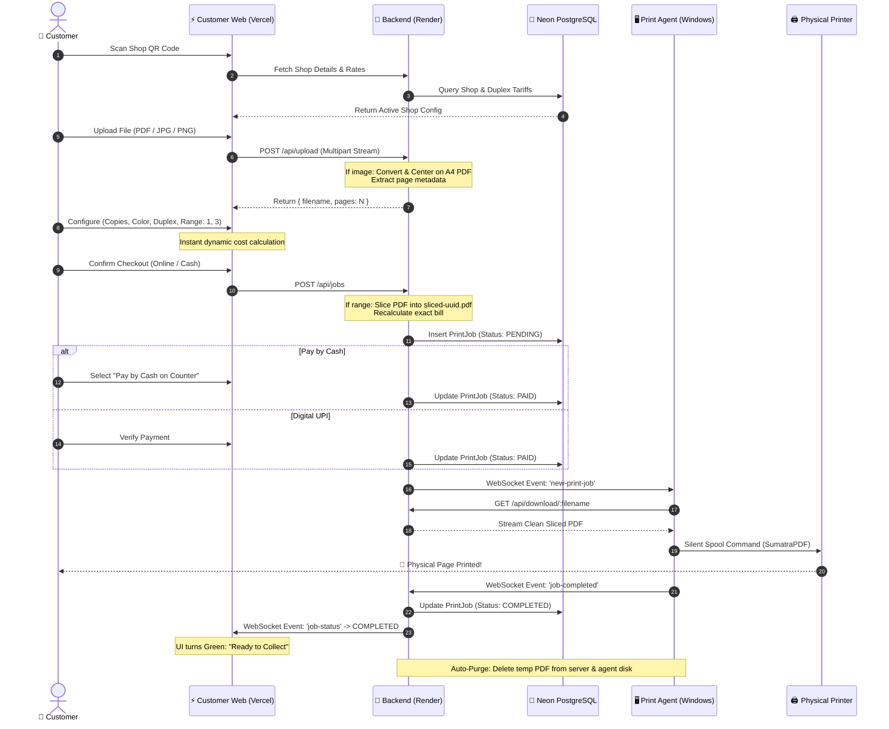

# 🖨️ PrintOS — Self-Service Cloud & Edge Printing Ecosystem

[](https://print-os-customer-web.vercel.app/)
[-black?style=for-the-badge&logo=next.js&logoColor=white)](https://nextjs.org/)
[](https://nodejs.org/)
[-00E599?style=for-the-badge&logo=postgresql&logoColor=white)](https://neon.tech/)
[](https://socket.io/)
[](https://microsoft.com/windows)
[](#-data-privacy--security-model)

> **PrintOS** is an end-to-end, privacy-preserving, smart self-service printing operating system that replaces the traditional, chaotic WhatsApp-based document printing pipeline at stationery and photocopy shops with a seamless, zero-touch scan-to-print cloud experience.

---

## 🌐 Live Product Experience

Experience the live deployed application in your browser:

### 🔗 **[Launch PrintOS Customer Web App](https://print-os-customer-web.vercel.app/)**
*(Try the live partner shop instance: **[PrintOS @ Bhadauria Printing Shop](https://print-os-customer-web.vercel.app/?shop=bhadauria-prints)**)*

> **Live Production Infrastructure**:
> * **Customer Web & Merchant Portal**: Hosted globally on **Vercel Edge Network**.
> * **Central Real-time Orchestrator**: High-concurrency Node.js WebSocket backend hosted on **Render**.
> * **Database & Multi-Tenant Registry**: Serverless PostgreSQL hosted on **Neon**.
> * **Local Print Agent**: Silent background daemon running on shopkeeper Windows machines with automated spooling to physical USB/LAN/Wi-Fi printers.

---

## 📌 Executive Summary

### The Traditional Problem (The WhatsApp Printing Chaos)
Every day, millions of students and professionals send personal documents (resumes, ID cards, passbooks, fee receipts, confidential certificates) to local stationery and photocopy shops via **WhatsApp**.

```
[ Customer Phone ] ──> (Sends PDF/Photo via WhatsApp) ──> [ Shopkeeper Personal Phone ]
                                                                      │
                                                        (Shopkeeper opens WhatsApp Web)
                                                                      │
                                                        (Manual download to public desktop)
                                                                      │
                                                        (Manual open in Acrobat / viewer)
                                                                      │
                                                        (Manual print dialog configuration)
                                                                      │
                                                        (Manual cash / UPI QR collection)
                                                                      │
                                                                      ▼
                                                          [ File remains on PC forever ]
```

**Fatal Flaws in Current Workflow:**
1. **Severe Privacy Breaches**: Sensitive documents remain stored on shopkeeper PCs and WhatsApp chat histories, vulnerable to leaks.
2. **High Bottlenecks & Missing Files**: Shopkeepers manually juggle multiple WhatsApp chats, often missing attachments or printing wrong page ranges.
3. **Wasted Counter Time**: Long queues form while customers wait for their WhatsApp messages to arrive and be downloaded manually.
4. **No Central Queue or Accounting**: No clear tracking of total daily prints, revenue reconciliations, or print job lifecycles.

---

### The PrintOS Solution (Scan • Configure • Pay • Collect)
PrintOS introduces a **Scan-to-Print Kiosk Protocol**:

```
[ Customer Phone ]
       │  (1. Scans shop-specific dynamic QR code)
       ▼
[ PrintOS Web App ] ──> (2. Uploads PDFs / Images / Screenshots)
       │                (3. Configures copies, color, duplex, custom page ranges)
       │                (4. Real-time transparent bill calculation)
       │                (5. Instant online / cash payment verification)
       ▼
[ Cloud Orchestrator ] ──(Real-time Encrypted WebSocket)──> [ Edge Print Agent ]
       │                                                              │
       │ (Auto-deletes file immediately)                              ▼
       └───────────────────────────────────────────────> [ Physical Printer Spools ]
```

* **No WhatsApp Sharing**: Direct HTTPS upload through progressive web app.
* **Zero Manual Touches**: Document is automatically ingested, converted/sliced, spooled to the printer driver, and printed.
* **Zero Data Retention**: Files are automatically purged from both server disk and local agent memory upon print confirmation.
* **Instant Billing**: Dynamic price engine computes rates based on color, B&W, duplex, paper size (A4/A3), and page selections.

---

## 🏛️ High-Level System Architecture

PrintOS is architected as a distributed hybrid-cloud IoT ecosystem combining a **Modern Cloud Control Plane** with a **Lightweight Edge Execution Plane**:



---

## ✨ Core Features & Technical Highlights

### 1. 📱 Zero-Install Customer Web Application
- **Universal Mobile Accessibility**: Built with responsive mobile-first UI using Next.js 14, Tailwind CSS, Lucide Icons, and Framer Motion.
- **Dynamic Multi-Shop Support**: Deep-linked routing (`/print?shop=<shopId>`) automatically loads partner shop branding, pricing tariffs, and live agent status.
- **Multi-File Upload Tray**: Support for multi-document cart checkout with individual configurations per file.

### 2. 🖼️ On-the-Fly Image-to-A4 PDF Normalization
- Customers frequently have screenshots or photos of IDs, marksheet, or receipts rather than clean PDFs.
- Built-in serverless pipeline powered by `pdf-lib` inspects raw image byte streams (`.png`, `.jpg`, `.jpeg`).
- Automatically calculates aspect ratio, scales image to fit standard A4 dimensions with a uniform `20pt` safety margin, centers it, and encapsulates it into a standard PDF on-the-fly.
- Shop print agent requires zero image-viewing software dependencies.

### 3. ✂️ Dynamic PDF Page Range Slicing & Sub-Item Billing
- Users often need only specific pages from a large document (e.g., page 1 & 3 of a 20-page syllabus).
- Customers can input arbitrary page selections: `1, 3, 5-8`.
- Backend parser validates bounds and generates an isolated, sliced PDF (`sliced-<uuid>.pdf`) containing only the targeted pages.
- Dynamic billing engine instantly updates cost calculations based on the exact sliced page count rather than the full document size.
- Allows mixed-setting configurations: a customer can add the same document twice (e.g., Page 1 in Color with 2 copies, and Page 2 in Grayscale).

### 4. 🖥️ Zero-Touch Desktop Edge Print Agent
- Packaged as a lightweight standalone Windows binary (`print-agent.exe`).
- **Silent Windows Boot Automation**: Interactive first-time CLI configuration automatically deploys a hidden VBScript daemon (`printos-agent.vbs`) into the user's `%APPDATA%\Microsoft\Windows\Start Menu\Programs\Startup` directory.
- Runs completely hidden in the background without terminal popups; all events are directed to `agent.log`.
- **Fault-Tolerant Queue Recovery**: If the shopkeeper machine boots up late or experiences internet drops, the agent automatically syncs with the database on reconnection and catches up with pending `PAID` jobs.
- **Hardware Agnostic**: Integrates with the native Windows print spooler via headless SumatraPDF CLI, delivering 100% compatibility across HP, Canon, Epson, Brother, and Ricoh printers.

### 5. ⚡ Live Bidirectional WebSocket Tracking
- Customers watch their order progress in real-time through a 3-stage animated indicator:
  1. `Payment Verified` (Green)
  2. `Printing Documents` (Active spooling indicator)
  3. `Ready to Collect` (Pickup alert)
- Shopkeeper dashboard receives instant live auditory and visual alerts when new jobs arrive.

### 6. 🔒 Ephemeral Storage & Zero-Retention Security
- Uploaded files are assigned cryptographically random UUID names.
- Files reside on server storage only for the duration of the print lifecycle.
- Once the edge print agent completes the physical print spool, a completion handshake triggers immediate deletion of files from both the cloud server disk and local agent temp storage.

---

## 🛠️ Complete Technology Stack

| Layer | Technology | Purpose |
|---|---|---|
| **Frontend Web App** | Next.js 14 (React, App Router) | Customer scan-to-print portal & Merchant dashboard |
| **Styling & Animation** | Tailwind CSS, Lucide React, Framer Motion | Modern dark-mode UI, responsive layouts, live tracking |
| **Edge Deployment** | Vercel Global Edge Network | Sub-50ms TTFB web delivery worldwide |
| **Backend API** | Node.js, Express, TypeScript | REST endpoints for uploads, shops, jobs, rate configs |
| **Document Engine** | `pdf-lib`, Multer, Node Crypto | On-the-fly image conversion, page range extraction |
| **Real-Time Communication** | Socket.IO (WebSockets + Polling fallback) | Low-latency bi-directional agent & client synchronization |
| **Database & ORM** | PostgreSQL (Neon Serverless), Prisma ORM | Relational multi-tenant schema with connection pooling |
| **Edge Print Daemon** | Node.js, PKG Standalone Executable, VBScript | Headless Windows background daemon with auto-boot |
| **Print Spooler Driver** | SumatraPDF Headless CLI & Windows Spooler | High-fidelity driver-agnostic physical print output |
| **Cloud Hosting** | Render Web Services | Production Node.js backend orchestration |

---

## 🔄 End-to-End Print Job Lifecycle



---

## 🔒 Data Privacy & Security Model

1. **No Intermediary Human Contact**: Customers never expose their contact numbers, personal chats, or gallery access to a shopkeeper.
2. **Short-Lived Ephemeral Storage**: Files exist on server storage strictly in a transient state until printed.
3. **Shop Secret Authentication**: Each print agent authenticates over WebSocket using a cryptographically hashed `Shop Secret Key` verified by the central backend.
4. **Isolated Multi-Tenant Access**: Shopkeepers can only inspect the queues, rates, and historical logs mapped to their authenticated `shopId`.
5. **No File Browsing**: Customers cannot browse or view files uploaded by other users. File endpoints enforce randomized UUID addressing.

---

## 📁 Showcase Repository Structure

```
PrintOS-Showcase/
├── README.md                      # Executive overview, architecture & live links
├── LICENSE.md                     # Proprietary software showcase license
├── docs/
│   ├── ARCHITECTURE.md            # Deep-dive system design & edge resilience
│   ├── FEATURES.md                # Detailed product feature breakdown
│   ├── LIVE_DEMO_GUIDE.md         # Step-by-step interactive demo walkthrough
│   └── SYSTEM_DESIGN_DIAGRAMS.md  # Complete collection of Mermaid architecture specs
└── .gitignore                     # Standard repository hygiene
```

---

## 🗺️ Product Vision & Roadmap

- [x] **Phase 1: Core MVP** — QR scan, web upload, auto print agent, basic billing.
- [x] **Phase 2: Commercial Resilience** — Windows auto-boot, background VBS runner, socket reconnection recovery.
- [x] **Phase 3: Smart Media Ingestion** — On-the-fly Image-to-A4 PDF conversion with margins and centering.
- [x] **Phase 4: Granular Customization** — Custom PDF page range slicing (`1, 3, 5-8`) with instant dynamic billing.
- [ ] **Phase 5: Self-Service Kiosks** — Touchscreen kiosk software with integrated bill-acceptor hardware.
- [ ] **Phase 6: Multi-Service Expansion** — Book binding, spiral binding, passport photo templates, and lamination orders.
- [ ] **Phase 7: Merchant Intelligence** — Daily revenue trends, toner depletion warnings, and paper inventory tracking.

---

## 📄 License & Proprietary Notice

This repository is published as a **Public Architecture & Product Showcase**. 

All original concepts, architecture designs, workflows, and intellectual property associated with **PrintOS** are **Copyright © 2026 Bhoopendra Singh Bhadauria. All Rights Reserved.**

*This repository does not contain production server secrets, proprietary API keys, or private database credentials. For enterprise inquiries, partnership opportunities, or technical demonstrations, please reach out via GitHub or email.*

---

<p align="center">
  <b>Built with ❤️ to modernize everyday document printing across local stationery shops.</b><br/>
  <sub>Designed & Developed by Bhoopendra Singh Bhadauria</sub>
</p>
