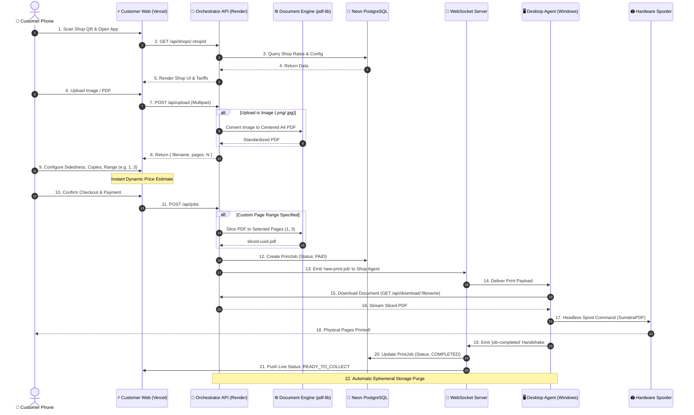
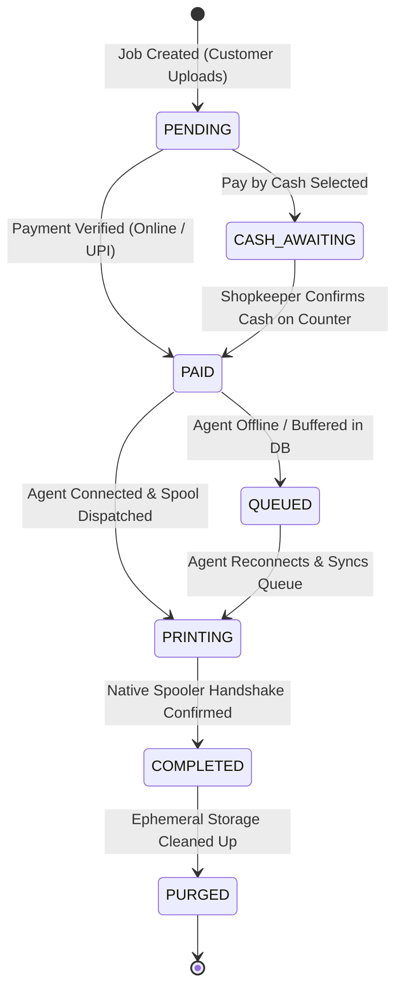
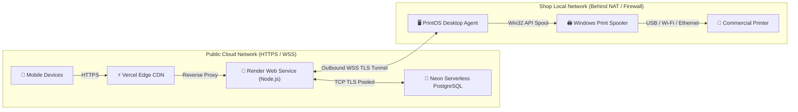
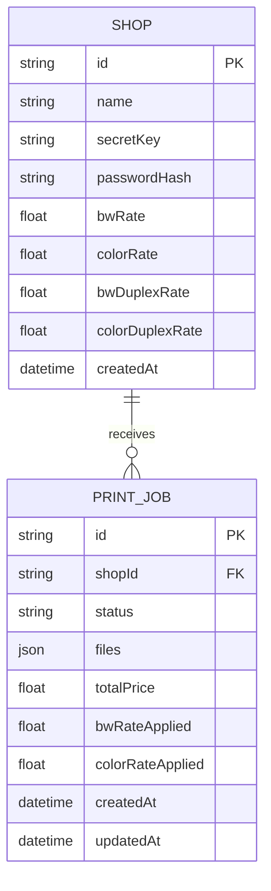

# 📊 PrintOS — System Design & Flow Diagrams

This document contains detailed visual representations of the PrintOS architecture, sequence flows, and edge execution models.

---

## 1. End-to-End System Sequence Flow

---

## 2. Print Job State Machine

---

## 3. Distributed Network Topology

---

## 4. Multi-Tenant Entity Relationship Model (ERD)

